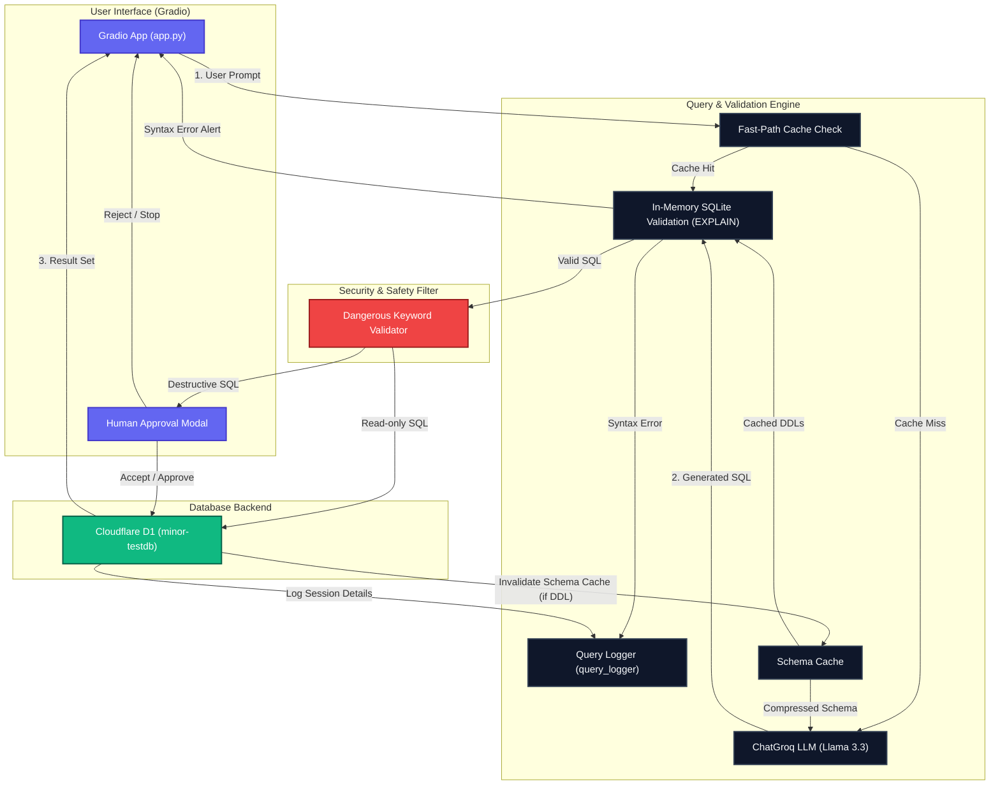

# 🌐 Natural Database Assistant

[](https://www.python.org/)
[](https://gradio.app/)
[](https://developers.cloudflare.com/d1/)
[](https://www.langchain.com/)

An intelligent, LLM-powered natural language interface for Cloudflare D1 databases. This project enables users to build schemas, query data, and explore databases using conversational English, while maintaining strict security checks and human-in-the-loop approvals for modifying actions.

---

## 🗺️ Table of Contents
- [✨ Core Features](#-core-features)
- [🏗️ System Architecture](#️-system-architecture)
- [🧩 Component Overview](#-component-overview)
- [🛡️ Safety & Validation Pipeline](#️-safety--validation-pipeline)
- [🚀 Quick Start & Installation](#-quick-start--installation)
- [⚙️ Environment Configuration](#️-environment-configuration)
- [📊 Monitoring & Logs](#-monitoring--logs)

---

## ✨ Core Features

*   **🗣️ Conversational SQL Generation**: Translates natural language prompts to precise SQLite/D1 queries using **Llama 3.3 (70B) via Groq** and structured outputs.
*   **⚡ Sub-millisecond Fast-Path Check**: Direct routing for common schema and table queries (e.g., *“show all products”*, *“list tables”*), bypassing LLM latency entirely.
*   **🩺 In-Memory Syntax Validation**: Runs compiler checks (`EXPLAIN <query>`) against a simulated schema in an in-memory SQLite database before executing on D1.
*   **🛡️ Safety Gate & Human-in-the-Loop**: Prompts for explicit manual confirmation via a modal interface before executing destructive/modifying commands (`INSERT`, `UPDATE`, `DELETE`, `CREATE`, `DROP`, `ALTER`).
*   **📁 Remote D1 Execution**: Executes queries on remote Cloudflare D1 database clusters using the Wrangler API wrapper.
*   **💾 Schema Caching**: Speeds up prompt engineering by caching and compressing schemas in-memory, automatically invalidating when DDL operations execute.
*   **📈 Audit Logs**: Records execution metrics, latency, success/failure, and token usage inside structured `logs/query_log.jsonl`.

---

## 🏗️ System Architecture

The following diagram demonstrates the lifecycle of a query from the user interface through the safety and validation steps, down to execution on Cloudflare D1:



---

## 🧩 Component Overview

The codebase is modularized with clear separation of concerns:

*   **[app.py](file:///d:/MinoriLabs-intern/D1-Assistant/app.py)**: The entrypoint. Configures the Gradio user interface tabs (Database Builder, Query Database, and Database Explorer) and implements modal logic for query approval.
*   **[services/sql_service.py](file:///d:/MinoriLabs-intern/D1-Assistant/services/sql_service.py)**: The brain of the SQL pipeline. Integrates LangChain prompts, handles structured LLM outputs, executes fast-path checking, and triggers in-memory compilation checks.
*   **[services/d1_service.py](file:///d:/MinoriLabs-intern/D1-Assistant/services/d1_service.py)**: Interface with Cloudflare D1. Features an in-memory `SchemaCache` with cache invalidation policies and executes commands remotely using Wrangler.
*   **[services/sql_validator.py](file:///d:/MinoriLabs-intern/D1-Assistant/services/sql_validator.py)**: Hardened validator block checking queries for sensitive keywords.
*   **[services/query_logger.py](file:///d:/MinoriLabs-intern/D1-Assistant/services/query_logger.py)**: Handles file logging into JSONL format, keeping detailed logs of user prompts, executed SQL, response types, and execution latencies.
*   **[services/llm.py](file:///d:/MinoriLabs-intern/D1-Assistant/services/llm.py)**: Setup code for initializing the ChatGroq model instance.
*   **[services/agent_service.py](file:///d:/MinoriLabs-intern/D1-Assistant/services/agent_service.py)**: Optional/Alternative agent-based LangChain system utilizing tool-calling chains.

---

## 🛡️ Safety & Validation Pipeline

Before any command is allowed to reach Cloudflare D1, it must pass through two layers of defense:

### 1. In-Memory SQLite Compilation Check (`EXPLAIN`)
To avoid running syntactic junk or invalid schema statements on the remote database:
1. The engine retrieves cached DDL statements (like `CREATE TABLE ...`) representing the remote database.
2. It constructs a mock database entirely in-memory using Python's `sqlite3`.
3. It compiles the generated query using the SQLite engine:
   ```sql
   EXPLAIN <generated_query>
   ```
4. If compilation fails (e.g., column does not exist, syntax typo), the pipeline halts and reports the compilation log.

### 2. Dangerous Action Interceptor
Modifying actions are protected behind a gate. If the query contains any of the following instructions:
*   `DROP`, `DELETE`, `ALTER`, `TRUNCATE`, `ATTACH`, `DETACH`, `UPDATE`, `CREATE`
The pipeline interrupts execution, alerts the user interface, and displays a modal requiring a physical human click to **Accept** or **Reject** the query.

---

## 🚀 Quick Start & Installation

### 1. Clone & Set Up Python Virtual Environment
Initialize a fresh virtual environment and install the required dependencies listed in **[requirements.txt](file:///d:/MinoriLabs-intern/D1-Assistant/requirements.txt)**:

```bash
# Clone the repository
git clone <repo_url>
cd D1-Assistant

# Create virtual environment
python -m venv venv

# Activate virtual environment (Windows Powershell)
.\venv\Scripts\Activate.ps1

# Install requirements
pip install -r requirements.txt
```

### 2. Cloudflare Wrangler Authentication
Make sure you have Node/NPM installed, then verify Wrangler is authenticated to your Cloudflare account:

```bash
# Login to Cloudflare
npx wrangler login

# Check D1 database connection
npx wrangler d1 list
```

---

## ⚙️ Environment Configuration

Create a **[.env](file:///d:/MinoriLabs-intern/D1-Assistant/.env)** file in the root directory and add your API keys:

```ini
GROQ_API_KEY=gsk_your_groq_api_key_here
```

Ensure your target database name is configured correctly in `DB_NAME` inside **[services/d1_service.py](file:///d:/MinoriLabs-intern/D1-Assistant/services/d1_service.py)**.

### Running the App
Once everything is configured, start the web interface:

```bash
python app.py
```
Open the local server URL (usually `http://127.0.5.1:7860`) in your browser.

---

## 📊 Monitoring & Logs
Logs are maintained in the root `logs/` directory inside `query_log.jsonl`. Each entry records:
*   `timestamp`: Execution date and time.
*   `question`: Original natural language question.
*   `sql`: The generated SQL query.
*   `latency_seconds`: Timing latency of query generation and validation.
*   `success`: Boolean status indicator.
*   `error_message`: Stack trace or exception logs if execution fails.
